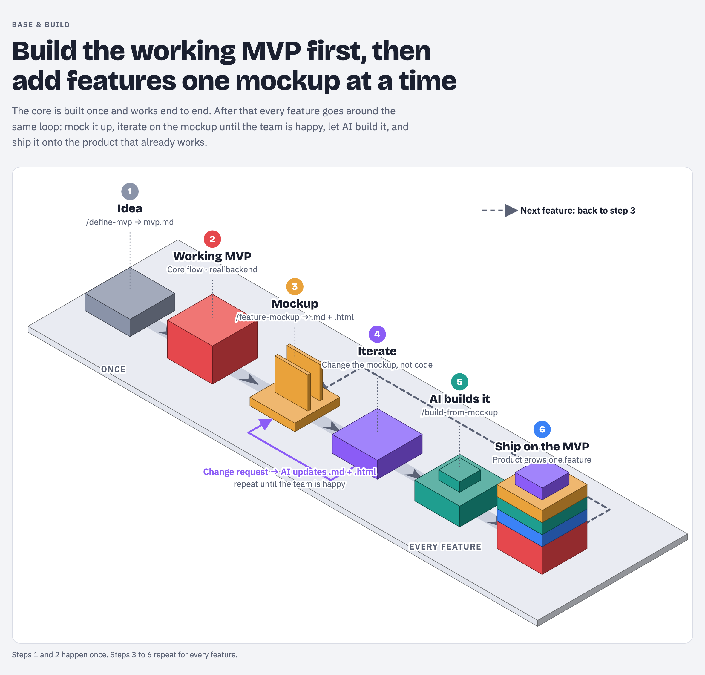

# XFactory

A starter template for building a product with AI and skills **as working MVP first, then one feature at a time, each designed as a mockup before any code is written.**



## Why this works

- **A working base before anything else.** Asking AI to build a whole product in one go
leaves features half working. A small MVP that runs end to end on real data gives every
later feature a real product to land on.
- **Iterate on documents, not code.** Design changes happen on a `.md` + `.html` mockup,
where they cost minutes and few tokens. Code is written once, from an approved mockup.


## What's in the template

```
x-factory/
├── AGENTS.md                     project rules for Claude: fill in stack and scripts
├── x-factory-flow.png       the flow diagram above
├── docs/
│   └── idea.md                   your whole idea: fill this in first
└── .claude/skills/
    ├── README.md                 index of the three skills
    ├── define-mvp/               /define-mvp: idea.md → docs/mvp.md
    │   └── assets/mvp.template.md
    ├── feature-mockup/           /feature-mockup: feature → .md + .html mockup
    │   └── assets/               PROFILE.template.md, mockup-frame.html
    └── build-from-mockup/        /build-from-mockup: approved mockup → working feature
```


| File                                                     | Who writes it                 | When                                   |
| -------------------------------------------------------- | ----------------------------- | -------------------------------------- |
| `docs/idea.md`                                           | You                           | Before anything else                   |
| `AGENTS.md`                                              | You                           | Once you pick the stack                |
| `docs/mvp.md`                                            | `/define-mvp`                 | Step 2, you iterate and approve        |
| `docs/design-docs/mockups/PROFILE.md`                    | `/feature-mockup` (first run) | Once, then kept current                |
| `docs/design-docs/mockups/README.md`                     | `/feature-mockup`             | One row per mockup, status kept current |
| `docs/design-docs/mockups/<date>-<feature>.md` + `.html` | `/feature-mockup`             | Every feature, you iterate and approve |
| `docs/plans/<date>-<feature>.md`                         | `/build-from-mockup`          | Every feature                          |


## How to use it


### 1. Start the project

```bash
npx degit deriv-com/x-factory <your-project>
```

Then in the project:

1. Fill in `docs/idea.md`: what it is, who uses it, every feature you can think of, the
  APIs it will use, platforms, look and feel, constraints. Write freely; nothing is a
   commitment yet.
2. Fill in `AGENTS.md`: stack, design system, backend and the dev / build / test / lint
  commands.
3. Scaffold the app so the dev server runs, `git init`, and keep API keys in `.env.local`.


### 2. Define the MVP (once)

Open Claude Code in the project and run:

```
/define-mvp
```

It reads `idea.md`, checks the real backend, and writes `docs/mvp.md`: the one core flow,
which API feeds each step, the "done when" checks and an ordered backlog of everything else.
Ask for changes until it's right, then say **approved**.

### 3. Build the MVP (once)

```
/feature-mockup the MVP
```

The first run creates `PROFILE.md` (design system, layout, breakpoints, data sources). The
MVP mockup is where you design the app shell. Review the `.html` (desktop, mobile portrait,
mobile landscape) and the `.md`, ask for changes until you're happy, then say **approved**.

```
/build-from-mockup the MVP
```

It writes a build plan, builds the MVP, runs the checks and compares the running app with
every mockup frame. Test the core flow yourself on real data, then commit.

### 4. Add features (repeat for each backlog item)

```
/feature-mockup <feature>         → review → ask for changes → "approved"
/build-from-mockup <feature>      → verify in the running app → commit
```

Then take the next item from the backlog in `docs/mvp.md`.

## Rules that keep it working

- One feature per build request.
- Design changes go into the mockup first, then into code.
- One `.md` + `.html` pair per feature for its whole life; no `-v2` copies.
- Nothing is built without `Status: Approved` on its mockup.
- Keep `PROFILE.md` current when the layout or design system changes.
- Secrets live in `.env.local`, never in tracked files.

